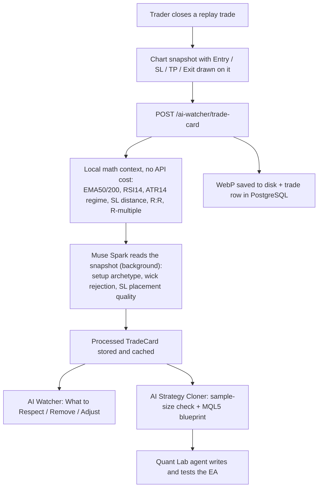

# BacktestAI: Autonomous Quant Agent for Institutional MQL5 Engineering, Smart Backtesting & MetaTrader 5 Simulation
> Powered by Meta `Muse Spark 1.3` & FastMCP

[](https://lablab.ai)
[](https://python.org)
[](https://www.metatrader5.com)
[](https://github.com/jlowin/fastmcp)
[](LICENSE)

---

## Executive Summary

**BacktestAI** is an institutional-grade, agentic quantitative strategy engineering and simulation platform designed for the **Meta Global AI Developer Hackathon** (participating in the *Indie Developer Track* and the *Best Agentic Use-Case*).

Most algorithmic trading tools rely on toy Python backtests over idealized CSV files that ignore market reality: spread widening, slippage, liquidity gaps, and broker-specific execution rules. **BacktestAI completely bridges this divide by turning Meta AI models into autonomous quantitative software engineers that plan, code, compile, and stress-test 100% native MQL5 Expert Advisors directly inside real MetaTrader 5 portable terminals.**

---

## Hackathon Disclosure

**Existing before the hackathon (as BacktestSI):**
- Product plans and strategy concepts
- A simple prototype chatbot
- Some frontend interfaces, such as the hero page

**Built during the hackathon (Oct 27 – Nov 4, 2026):** everything else.

---

## 1. What BacktestAI Does

BacktestAI has two connected workspaces:

1. **Backtest Studio (manual replay + Meta AI coach):** the trader replays historical candles bar by bar and trades by hand. Every closed trade is captured as a chart snapshot and a structured *TradeCard*. Meta's Muse Spark reads the snapshot, the AI Watcher coaches the trader's behavior, and the AI Strategy Cloner turns the trader's manual edge into a strategy blueprint.
2. **Quant Lab (autonomous agent):** an AI agent turns a strategy idea or a cloned blueprint into a native MQL5 Expert Advisor, compiles it with MetaEditor, fixes compiler errors, and backtests it in a real MetaTrader 5 Strategy Tester.

---

## 2. Meta Models in BacktestAI

All Meta calls go through one adapter, [`packages/agent/src/adapters/meta_models.py`](packages/agent/src/adapters/meta_models.py), which talks to the Meta Model API (`/chat/completions`, with image input).

| Meta model | Where it is used | What it does |
| :--- | :--- | :--- |
| **`muse-spark-1.3-contributor`** (Adviser) | Chart Vision, AI Watcher, AI Strategy Cloner | Reads each closed trade's chart snapshot (multimodal), classifies the setup, coaches the trader, and reverse-engineers the trading edge |
| **`muse-spark-1.3`** (Executor) | Quant Lab agent (provider `meta`) | Drives the agent loop: chat, tool calls, MQL5 code, compile-and-fix, backtest |

Configured with `META_MODEL_EXECUTOR` and `META_MODEL_ADVISER` in `.env`. When no API key is set, every Meta feature falls back to a local rule-based mode so the app keeps working offline.

---

## 3. Backtest Studio AI Suite (Meta Spark)



- **TradeCard (~200 tokens):** each trade is sent to the model once as a compact card. The heavy image is dropped after vision tagging, and already-processed trades are never sent again.
- **AI Watcher coach:** reviews the whole session (win rate, R-multiples, setups, SL quality) and returns three lists: what to keep doing, what to stop doing, what to adjust.
- **AI Strategy Cloner:** checks if the sample is large enough (under 5 trades: insufficient, 5-14: sufficient, 15+: optimal), then extracts entry rules, exit rules, and MQL5 input parameters into a blueprint for the Quant Lab agent.

---

## 4. Quant Lab Agent Workflow

1. **Discussion:** the agent talks through the idea and can search the web (`search_web`, `read_web_page`).
2. **Blueprint gate:** for a new strategy it writes an 8-block *Quant Strategy Blueprint* and asks the trader to approve it once (`ask_user`).
3. **MQL5 code:** it creates one `.mq5` file per strategy and writes the full Expert Advisor.
4. **Compile and self-heal:** it compiles with MetaEditor (`compile_mql5`), reads the error log, and fixes the same file until there are 0 errors.
5. **Backtest:** it runs the MT5 Strategy Tester on real tick data (`run_strategy_tester`, `Model=0`).
6. **Autopsy:** it parses the report and analyzes long vs. short performance, losing hours, and SL/TP hits.

### Zero-Trade Rule
A backtest with **0 trades counts as a failure**. Every generated EA prints 4 diagnostic counters in `OnDeinit()`:

| Counter | Meaning |
| :--- | :--- |
| `g_ticks_total` | Ticks the EA received |
| `g_blocked_by_time` | Ticks rejected by the session/time filter |
| `g_blocked_by_spread` | Ticks rejected by the spread filter |
| `g_signals_found` | Entry signals detected |

When a test returns 0 trades, the platform reads these counters from the tester log, names the bottleneck (for example "spread filter blocked 92% of ticks"), and the agent fixes that filter, recompiles, and runs the test again.

---

## 5. Agent Toolkits

| Toolkit | Tools | Purpose |
| :--- | :--- | :--- |
| **Workspace** (`packages/agent`) | `create_file`, `edit_file`, `edit_file_partially`, `read_file`, `search_in_files`, `ask_user` | Manage strategy files per user and ask the trader for decisions |
| **Research** | `search_web`, `read_web_page` | Web research and MQL5 documentation |
| **MetaTrader 5 FastMCP** (`packages/mt5_mcp`) | `compile_mql5`, `run_strategy_tester`, `read_test_report`, `copy_rates_range`, `get_symbol_info`, ... (28 tools; live `order_send` is not given to the agent) | Compile, test, read reports, and pull market data from portable MT5 terminals |

---

## 6. MT5 Worker Pool

MetaTrader 5 runs one Strategy Tester job per terminal, so BacktestAI keeps a pool of **5 portable MT5 terminals** (`worker_1` .. `worker_5`):

- A job leases the first free worker; when all 5 are busy, jobs wait in a FIFO queue and take the next worker that frees up.
- Compiled EAs (`shared_experts/`) and tick history (`shared_bases/`) are shared between workers through NTFS junctions.
- Long-running work (backtests, parameter sweeps, agent turns, data sync) can run in background workers through **Redis + ARQ**.

-> **Setup Guide:** [**`MT5_PORTABLE_SETUP.md`**](MT5_PORTABLE_SETUP.md)

---

## 7. Quick Start

### 1. Prerequisites
- Windows 10/11 64-bit
- Python 3.12+
- Node.js 18+ (pnpm / npm)
- Any MetaTrader 5 portable installation

### 2. Installation & Setup
```bash
# Clone the repository
git clone https://github.com/khattabi1/BacktestAI.git
cd BacktestAI

# Create and activate Python virtual environment
python -m venv .venv
.venv\Scripts\activate

# Install root dependencies
pip install -r requirements.txt

# Install domain and MT5 MCP packages in editable mode
pip install -e packages/domain
pip install -e packages/mt5_mcp

# Initialize PostgreSQL database & seed baseline demonstration data
python scripts/seed_demo_data.py

# Provision the 5-worker MT5 fleet
powershell -ExecutionPolicy Bypass -File scripts/replicate_workers.ps1

# Verify FastMCP connection and tool registration
python packages/mt5_mcp/scripts/verify_setup.py
```

### 3. Run Development Servers
```bash
# Terminal 1: Start FastAPI backend
uvicorn apps.api.src.main:app --reload --port 8000

# Terminal 2: Start Redis execution worker (ARQ Distributed Queue)
python -m arq apps.api.src.worker.WorkerSettings

# Terminal 3: Start Next.js frontend (in another terminal)
cd apps/web && npm run dev
```

---

## 8. Legal, Ethical & Regulatory Notice

- **Open Source:** BacktestAI is released under the [MIT License](LICENSE).
- **MetaTrader 5 & MetaEditor** are registered trademarks of MetaQuotes Software Corp. BacktestAI does not redistribute proprietary binary files (`.exe`). Users supply their own client terminal.
- **Regulatory Notice:** BacktestAI is an **algorithmic testing, quantitative research, and simulation platform**. It does not execute live financial transactions with real funds, offer personalized financial advice, manage client assets, or solicit investments.
